<!-- ═══════════════════════════ HEADER ═══════════════════════════ -->


<div align="center">

<p>
  <a href="mailto:corredorsilvafelipe8@gmail.com"></a>
  <a href="https://www.linkedin.com/in/felipe-corredor-95664434b/" target="_blank"></a>
  <a href="https://github.com/corredor29?tab=repositories"></a>
  
</p>

</div>

---

## 👨‍💻 Sobre mí

Soy **desarrollador Full-Stack con foco en Backend**. Me gusta diseñar sistemas que se puedan mantener y escalar: dominio limpio, capas bien separadas y APIs predecibles.

```csharp
var felipe = new Developer
{
    Role  = "Full-Stack & Backend",
    Core  = ["C#", ".NET", "Clean Architecture"],
    Front = ["React", "Vue.js", "TypeScript"],
    Data  = ["PostgreSQL", "MySQL", "Oracle"],
    AI    = ["n8n", "Twilio", "ElevenLabs"],
    Motto = "Código que otro dev agradece leer."
};
```

<table>
  <tr>
    <td width="33%" valign="top">
      <b>🔭 Ahora mismo</b><br/><br/>
      Backends con <b>.NET</b> y Clean Architecture, CI/CD por entorno y agentes de voz con <b>n8n</b>.
    </td>
    <td width="33%" valign="top">
      <b>🌱 Aprendiendo</b><br/><br/>
      Arquitecturas orientadas a eventos, observabilidad y testing de integración.
    </td>
    <td width="33%" valign="top">
      <b>⚡ Dato curioso</b><br/><br/>
      Si algo se repite tres veces, lo automatizo.
    </td>
  </tr>
</table>

---

## 🛠️ Stack tecnológico

<div align="center">

<table>
  <tr>
    <td align="center" width="140"><b>Backend</b></td>
    <td></td>
  </tr>
  <tr>
    <td align="center"><b>Frontend</b></td>
    <td></td>
  </tr>
  <tr>
    <td align="center"><b>Datos</b></td>
    <td>&nbsp;</td>
  </tr>
  <tr>
    <td align="center"><b>DevOps & Tools</b></td>
    <td></td>
  </tr>
  <tr>
    <td align="center"><b>IA & Automatización</b></td>
    <td>
      
      
      
      
    </td>
  </tr>
</table>

</div>

---

## 🚀 Proyectos destacados

<table>
  <tr>
    <td width="50%" valign="top">
      <h3>📦 SmartInventory Ecosystem</h3>
      <p>Gestión de inventario empresarial con arquitectura limpia y desacoplada: API, frontend y chatbot con IA.</p>
      <p>
        <a href="https://github.com/corredor29/SmartInventoryAPI"></a>
        <a href="https://github.com/corredor29/smartinventory-frontend"></a>
        <a href="https://github.com/corredor29/smartinventory-chatbot"></a>
      </p>
      <sub><code>C#</code> · <code>.NET Core</code> · <code>TypeScript</code> · <code>Python</code> · <code>MySQL</code></sub>
    </td>
    <td width="50%" valign="top">
      <h3>🤖 Agente Telefónico con IA</h3>
      <p>Agente conversacional que atiende llamadas en tiempo real, orquestado con n8n y voz generativa.</p>
      <p>
        <a href="https://github.com/corredor29/Agente-Telef-nico-con-IA-n8n-Twilio-ElevenLabs-"></a>
        <a href="https://github.com/corredor29/flujo_n8n_trabajo"></a>
      </p>
      <sub><code>n8n</code> · <code>Twilio</code> · <code>ElevenLabs</code> · <code>Webhooks</code></sub>
    </td>
  </tr>
  <tr>
    <td width="50%" valign="top">
      <h3>📄 CV Analyzer</h3>
      <p>Extrae y estructura automáticamente la información de hojas de vida y perfiles profesionales.</p>
      <p>
        <a href="https://github.com/corredor29/cv_analyzer"></a>
      </p>
      <sub><code>Python</code> · <code>Data Extraction</code> · <code>Automation</code></sub>
    </td>
    <td width="50%" valign="top">
      <h3>⚡ Jarvis</h3>
      <p>Asistente personal en C# para automatizar tareas diarias y controlar el entorno de desarrollo.</p>
      <p>
        <a href="https://github.com/corredor29/Jarvis"></a>
      </p>
      <sub><code>C#</code> · <code>.NET</code> · <code>Productividad</code></sub>
    </td>
  </tr>
</table>

---

## 📊 Actividad en GitHub

<div align="center">


</div>

---

<div align="center">

<sub>💬 ¿Tienes un proyecto backend, una automatización o una idea con IA? <b>Hablemos.</b></sub>

</div>

